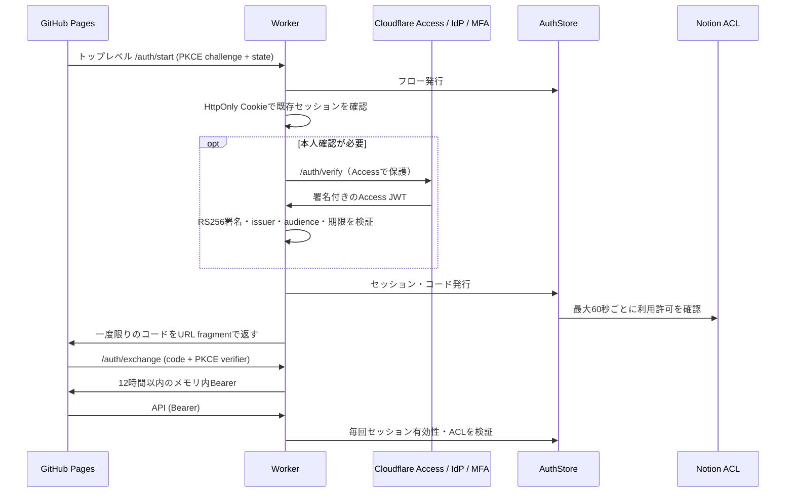

# 認証の構成と切り替え

## 状態

コード実装、33件のテスト、CloudflareローカルエンジンでのSQLite・API保護を確認し、本番へ公開済み。Notion ACLの接続と実ユーザーによる認証テストを完了して運用確認を行う。

## 構成

- UI: GitHub Pages `https://furuta-ideas.github.io/TourRuncher/`
- 認証・API: `https://tour-playbook-api.furuta-ideas.workers.dev`
- 本人確認: Cloudflare Access + Google / Microsoft / Apple等の設定済みIdP + independent MFA
- 利用許可: Notion `Playbook_ACL`, source `3fdcbc41-2aed-80e5-a91e-000b1d60d3fb`
- セッション: SQLite-backed Durable Object `AuthStore`（Workers Free対応）

サードパーティCookieは使用しない。認証CookieはWorkerをトップレベルで開いた際のみ使用。コードは60秒・一度限りで、フロントで作ったverifierがなければ交換不可。外部IDのトークンをPages URLへ返さない。

## Cloudflare側の必須設定

1. Zero Trust組織を用意し、無料枠・利用人数・対象機能を確認する。契約条件や課金に関する同意は所有者が行う。
2. Google等のIdPを登録する。Googleは専用OAuthクライアント、Microsoftは利用者の組織/個人アカウントに適合するクライアントが必要。AppleはServices ID・署名鍵等が必要。秘密値はCloudflareのIdP設定へ入力し、Gitやチャットに貼らない。
3. `tour-playbook-api.furuta-ideas.workers.dev/auth/verify` を対象とするself-hosted Accessアプリを作成。他のパスはAccessで保護しない（APIが認証画面へリダイレクトされるのを防ぐ）。Worker全体を保護する簡易スイッチはこの構成では使わない。
4. 当該アプリ・許可ポリシーで独立MFAを必須化。許可方法は `biometrics`, `security_key`。IdPのMFAを採用する場合は対応AMRが検証された場合のみ。メールOTPだけのポリシー、Bypass、Service Auth、MFAを無効にする別Allowポリシーを作らない。
5. 個人端末向けAccessのアプリ・ポリシー期間を30日以内に設定。MFA期間も30日以内。Cloudflare One Clientによる認証スキップは使わない。アプリ側では個人30日・共有12時間を別途上限とする。
6. アプリのAUDとチームのissuer (`https://TEAM.cloudflareaccess.com`, 末尾スラッシュなし) を控える。
7. MFAを実ユーザーで通過できること、MFA未完了で `/auth/verify` が到達不能なことを確認してから、Workerへ `CF_ACCESS_ISSUER`, `CF_ACCESS_AUD`, `CF_ACCESS_MFA_CONFIRMED=1` を設定する。最後の値だけを先に設定してもMFA保護は作られない。ポリシー設定とセットで必須。

`CF_ACCESS_MFA_CONFIRMED` は管理者による設定検証の完了フラグ。JWTは認証アプリの署名・AUDを検証するが、独立MFAの強度をJWT本文から推測しない。MFAの保証はそのAUDを発行するCloudflare Accessポリシーに依存する。ポリシー変更は管理者だけに限定する。

## Notion側の必須設定

- アプリのNotionインテグレーションにACLの読み取り権限を付ける。Playbookだけの接続では、別の親にあるACLに届かない場合がある。
- ACLの編集は管理者だけ。親ページから継承する編集権限も確認し、一般利用者にはACLを編集させない。アプリのインテグレーションは読み取り専用が望ましい。
- 「利用許可」チェックがオンで、重複のないメールアドレスがある行だけを許可。「有効期限」は任意。日付だけの場合は日本時間の当日末まで。
- 新規の「利用許可」は初期値オフ。既存29件は所有者の明示承認を受けてすべてオンに変更済み（29件・メール重複なしを確認）。新規行を自動許可しない。
- 「権限」列は説明用の既存値。アプリではこれをNotion編集権限や管理者権限に変換しない。
- 初回照合はCloudflareで確認したメールと行の完全一致。Gmailのドット除去や別名推測を行わない。初回成功後に `(issuer, sub)` とACL行IDを紐付け、異なるアカウントへの自動付け替えを拒否する。
- Appleの非公開メールは中継アドレスになる。使用するログインアドレスがACLと異なる場合は管理者が確認する。

## 期限・停止・復旧

- すべての端末: 最大30日、固定期限。利用者による端末区分の選択は設けない。Access JWTの有効期限を超えない。
- セッションの更新は期限を延ばさない。短期Bearerは12時間以内。期限前にトップレベル認証で交換し直す。画面のタブ・スクロール位置は更新時に戻る場合がある。
- 全APIでセッション保存先を確認。ACLは最大60秒のキャッシュ。画面は30秒ごと、およびSafariの復帰時に確認するため、表示の消去は最大約90秒（ネットワーク応答時間を除く）。APIは許可の再確認後に拒否する。
- Notionへの接続が失敗した場合、60秒を超えた許可キャッシュではデータAPIを許可しない。表示中の機密情報も隠す。
- 利用停止: ACLの「利用許可」をオフ。既存セッションは失効し、再びオンにしても古いセッションは復活しない。60秒内にオフ→オンを完結すると停止を観測できないため、停止を反映させてから再許可する。
- パスキーの秘密鍵・生体情報はアプリ・Notionへ保存しない。登録・復旧はCloudflareのMFA管理を使用し、メールOTPだけのアプリ独自バイパスは作らない。
- 再登録/アカウント変更時: 管理者が本人確認し、ACLを一旦停止、失効反映後にCloudflareの認証器・アカウントを管理者手順で復旧。必要ならAuthStoreのbindingsの対象行を管理者がリセットし、監査記録を残す。共有アカウントでは個人を識別できないため、個人ごとのIdPを使用する。
- 「全端末からログアウト」はアプリの全セッションを失効。ログアウト時はCloudflare Accessのログアウトも行う。外部Google等のアカウント自体のログアウトとは別。

## キャッシュと機密データ

ツアー10件・事前準備は認証中のメモリのみ。起動時に旧localStorageの機密キャッシュを削除し、ログアウト・失効・画面離脱時にメモリとDOMを消す。認証Bearerは永続保存しない。30日保持するのはHttpOnly Cookieで、サーバー側はそのハッシュのみ保存。個人端末の選択だけは非機密の設定としてlocalStorageに保存。

ダウンロード済みファイル、スクリーンショット、既に発行した配布元の署名URLは遠隔回収できない。公開FAQマスターは引き続き公開データであり、このログインで非公開にはならない。

## 切り替えチェック

1. `pnpm install --frozen-lockfile` / `node --test` / `wrangler deploy --dry-run`。
2. 別の検証Worker・別のAuthStoreで、実IdPとMFA、ACL未許可、無効化、期限切れ、ログアウトを確認。
3. iPad Safariで初回パスキー登録・再起動後の復帰・プライベートブラウズ・通信断・トークン更新・戻る操作でのデータ消去を実機確認。
4. 本番Accessアプリ・環境変数・Notion接続を検証後、WorkerとPagesを切り替える。この間の短いログイン停止時間を設け、旧パスワード認証を併存させない。
5. `APP_PASSWORD` Secretを削除し、必要なら `SESSION_SECRET` をローテーション。旧Bearer、旧フォームPOSTダウンロードで401/410になることを本番確認。
6. 本番リリース日時を更新。所有者のログインとNotionデータ取得を最終確認してから完了とする。

## 公式仕様

- https://developers.cloudflare.com/cloudflare-one/access-controls/access-settings/independent-mfa/
- https://developers.cloudflare.com/cloudflare-one/access-controls/access-settings/session-management/
- https://developers.cloudflare.com/cloudflare-one/integrations/identity-providers/google/
- https://developers.cloudflare.com/durable-objects/platform/pricing/
